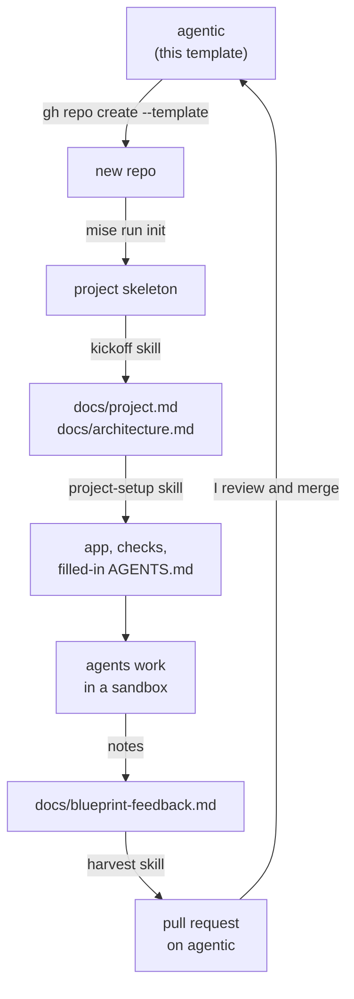
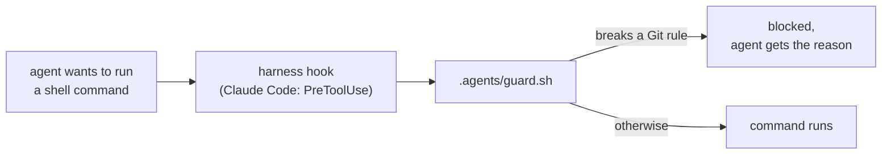
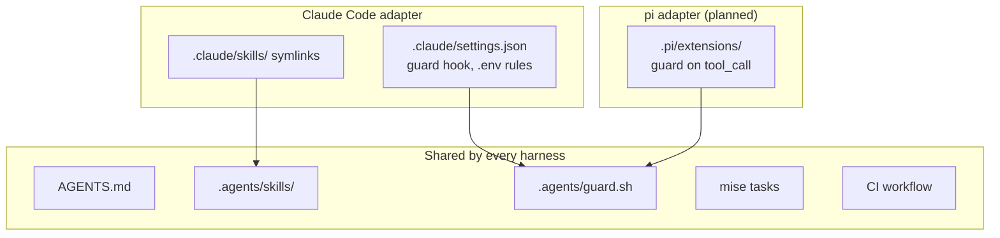

# agentic-blueprint

My blueprint for new projects. Every project created from it starts with the
agentic layer already in place: instructions every coding agent reads, guard
rails, a sandboxed agent, skills to define and set up the project, checks in
CI, and a loop that brings lessons from projects back here.

It carries no app code and no stack: the app is created per project with the
stack's own tools. It serves small one-off projects and full products alike.

**Status:** work in progress, built topic by topic to learn current best
practices. [.blueprint/ROADMAP.md](.blueprint/ROADMAP.md) shows where it is
going; [.blueprint/LEARNINGS.md](.blueprint/LEARNINGS.md) records every
decision and why.

## The lifecycle



## Starting a project

Once: mark this repository as a template (GitHub → Settings → General).
Then, for each new project:

```sh
gh repo create my-app --private --template Schwub/agentic --clone
cd my-app && mise trust && mise run init
git push
mise run agent
```

In the agent, run `/kickoff`, then `/project-setup`.

- **`mise trust`** allows mise to load the project's `mise.toml`, which can run code.
- **`mise run init`** turns the copy into a project. It puts the AGENTS.md
  template above the working agreements, writes a README stub and
  `docs/blueprint-feedback.md`, removes everything blueprint-only and
  commits. It refuses to run anywhere but a fresh one-commit repo.
- **`mise run agent`** starts Claude Code in a Docker sandbox on a private
  clone of the project.

## What every project gets

### Instructions every agent reads
`AGENTS.md` has two parts:
- **Project sections** (commands, what "done" means, conventions, gotchas,
  boundaries): only what an agent can't work out from the code. They start
  as a template that the project-setup skill fills in.
- **Working agreements:** my defaults for communication, when to ask,
  scope, verification and Git. They are maintained only here and are the
  same in every project.

There is deliberately no `CLAUDE.md`. Claude Code would then ignore
`AGENTS.md`, and pi would read both.

### Skills

| Skill | When | What it does |
|---|---|---|
| `kickoff` | Start of a project, or when goal or scope change | Interviews me at small or product depth, challenges vague answers, writes `docs/project.md` (and `docs/architecture.md` for products). No code. |
| `project-management` | During project-setup, or when a project outgrows its tracking | Picks how tasks are tracked, from a list in `docs/project.md` to a task tool, against fixed criteria; sets it up and records why. |
| `project-setup` | After kickoff, or when the stack changes | Creates the app with the stack's generator, adds `check:*` tasks, fills in `AGENTS.md` and runs every command it writes down. Proposes recommended skills that fit, e.g. `frontend-design` when there is a user interface. |
| `harvest` | Here only, e.g. weekly | Reads the feedback of all projects and proposes blueprint changes as one pull request. Removed from projects by `init`. |

Skills follow the [Agent Skills](https://agentskills.io) standard and live in
`.agents/skills/`. pi reads that folder directly; Claude Code reaches them
through per-skill symlinks in `.claude/skills/`.

### Task tracking
Decided per project, not fixed here: tools in this space change too fast.
The `project-management` skill applies fixed criteria (works in the sandbox
without tokens, any harness, leaves agent files alone, never commits on its
own, pinnable) to a maintained candidate list. Small projects usually keep
the "First steps" list in `docs/project.md`; for products the current
recommendation is [Backlog.md](https://github.com/MrLesk/Backlog.md), with
tested settings. Better candidates found in projects reach the list through
`harvest`.

### Guard rails



- **`.agents/guard.sh`** blocks commands that break the Git rules:
  discarding uncommitted work (`reset --hard`, `clean`, `checkout .`,
  `restore`, `stash`), force-push, bypassing hooks (`--no-verify`,
  `commit -n`) and staging everything (`add -A`, `add .`, `commit -a`). It is
  plain `sh`, so any harness can call it. It matches text, so it is a net,
  not a wall: a quoted example of a blocked command is blocked too.
- **Secrets:** Claude Code may not read `.env` files (`.env.example` stays
  readable), and `.gitignore` keeps them and local agent settings out of git.
- **Sandbox:** agents run in Docker Sandboxes on a private clone. The Git
  rules say what each environment may do: commit to a task branch in the
  sandbox, push the session branch in a cloud session, otherwise only when asked.

### Checks and CI
- **`mise run check`** runs every `check:*` task. Projects add their own
  checks (lint, tests, build) as new tasks without editing `check`.
- **`.github/workflows/check.yml`** runs `mise run check` on every push and
  pull request, so local and CI checks can't drift apart.

### Feedback to the blueprint
Agents note in `docs/blueprint-feedback.md` when a working agreement or skill
misled them or was missing, or when they built a skill other projects could
use. It is a finishing step in the working agreements, and both skills end
with it. The project agent never touches this repository; the `harvest`
skill pulls the notes in:

- **Adopt** what generalises and happened twice, or is clearly a bug.
- **Watch** what happened once, until a second project hits it.
- **Reject** what is project-specific, with the reason.

## Harness-agnostic by design



Everything that can be shared is shared; each harness gets only a thin
adapter. Claude Code is supported today. pi reads `AGENTS.md` and
`.agents/skills/` already; its guard adapter will be added when I use it.

## Working on the blueprint itself

| Path | What |
|---|---|
| `AGENTS.md` | Instructions for agents working here, then the working agreements |
| `.agents/` | Guard and its tests, skills (with the AGENTS.md template and guide in `project-setup/`) |
| `.claude/` | Claude Code adapter: settings with the guard hook, skill symlinks |
| `mise.toml` | `agent`, `check` and `check:*`; below "Blueprint only": `init` and its test |
| `.github/workflows/check.yml` | CI |
| `.blueprint/` | Roadmap, decision log, research, `init`, harvest record; removed by `init` |

`mise run check` also tests `init` on throwaway repos, including that it
refuses to run in the blueprint itself.

## Requirements

- [Claude Code](https://code.claude.com)
- [mise](https://mise.jdx.dev) for tasks and tool versions
- [Docker Sandboxes](https://docs.docker.com/ai/sandboxes/) (`sbx`) for sandboxed agents
- [GitHub CLI](https://cli.github.com) (`gh`) to create projects from the template

## Not verified yet

- Creating a project with `gh repo create --template` and running `mise run init` through mise.
- `mise run agent`: whether the sandbox loads `AGENTS.md`, the skills and the guard hook.
- The kickoff, project-setup and harvest skills in a real project.
