# User flows (M1)

M1 covers core use cases 1 and 2 from `docs/project.md`: add an album by
search or by sharing a link, and give it tags, a rating and a comment.
Tags are designed in [../features/tags.md](../features/tags.md); their
flows are at the end of this file.
Screens are listed in [screens.md](screens.md).

## Sign in (emailed code or link)

Done: the user is signed in and sees their shelf; they stay signed in
across app restarts. A new email signs up in the same way.

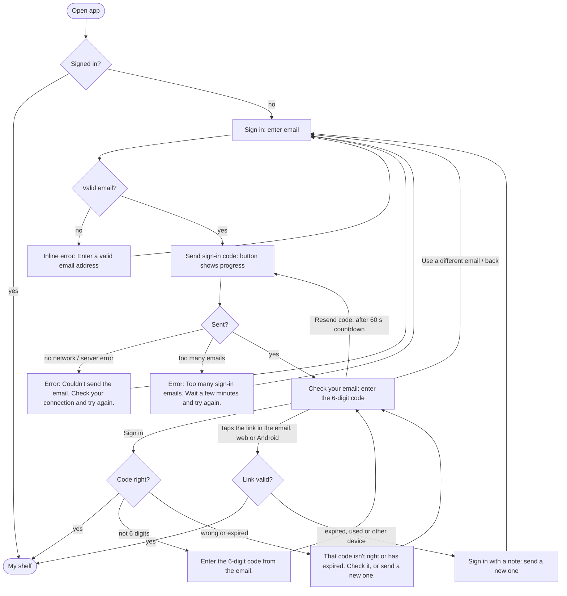

Notes:
- The email carries both the code and the link (staging: only the link,
  see docs/architecture.md). The code works on any device; the link signs
  in where it was requested: the web app, or the Android app through
  `de.schwubware.shelf://login` (iOS: TASK-20). An expired, used or
  other-device link returns to Sign in with the note "This link has
  expired or was already used. Send a new one below."
- A pending shared link (see "Add by sharing") survives the sign-in and
  continues afterwards.
- Sign out lives in the shelf's overflow menu and asks for confirmation.

## Add by search

Done: the album is on the shelf with any tags chosen, and the user is
back on the shelf with confirmation.

## Add by sharing a link

Done: the shared album is on the shelf.

## Tags, rating and comment

Done: the change is saved and visible on the shelf.

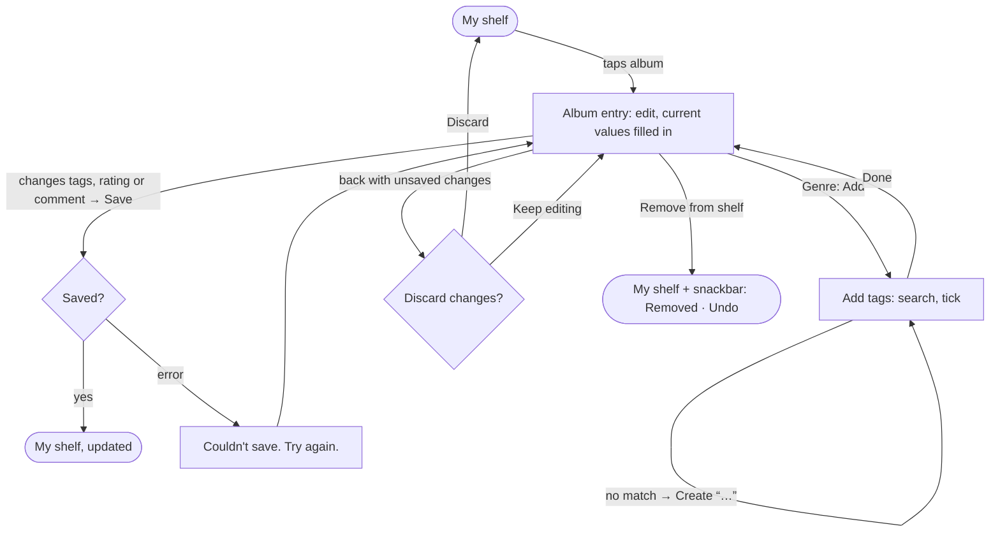

## My shelf: browsing

Done: the user finds an album on their shelf.

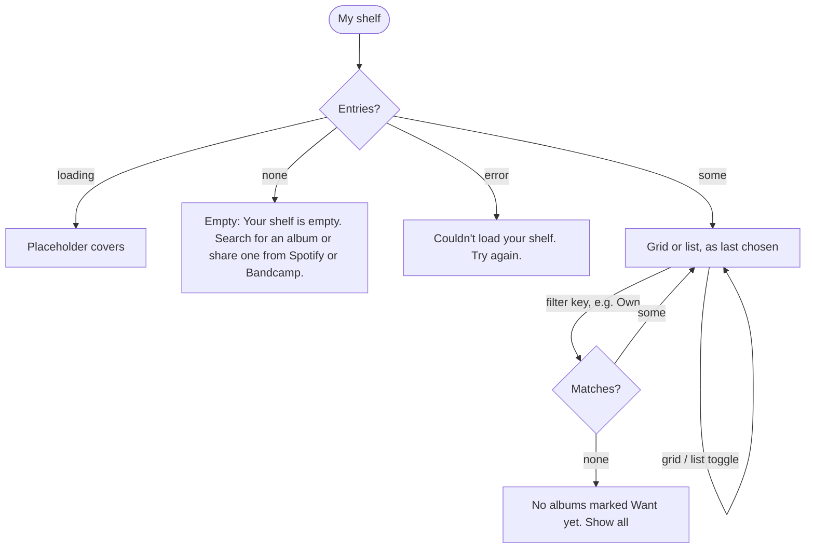

## Tag editor

Done: the user's groups and tags are as they want them, and every album
screen and filter reflects the change.

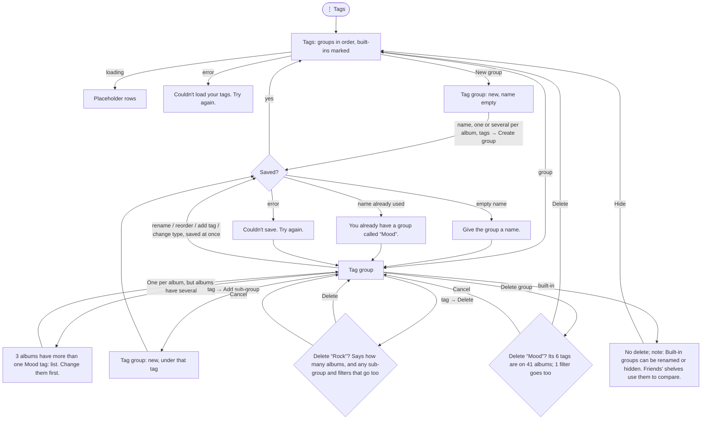

Notes: changes save immediately; deletes ask first and take effect at once.
Tag names are unique within a group, ignoring case, and can't be empty;
the same inline errors apply to tags. Deleting a tag also deletes the
sub-group under it and any filter on it. Sub-groups go one level deep.
Only built-in groups can be hidden.

## Filters

Done: the filter bar shows the chosen filters in the chosen order.

## Add from a friend (M2)

Done: the album is on the user's shelf with the friend's tags they tapped;
new ones are ordinary, editable tags.

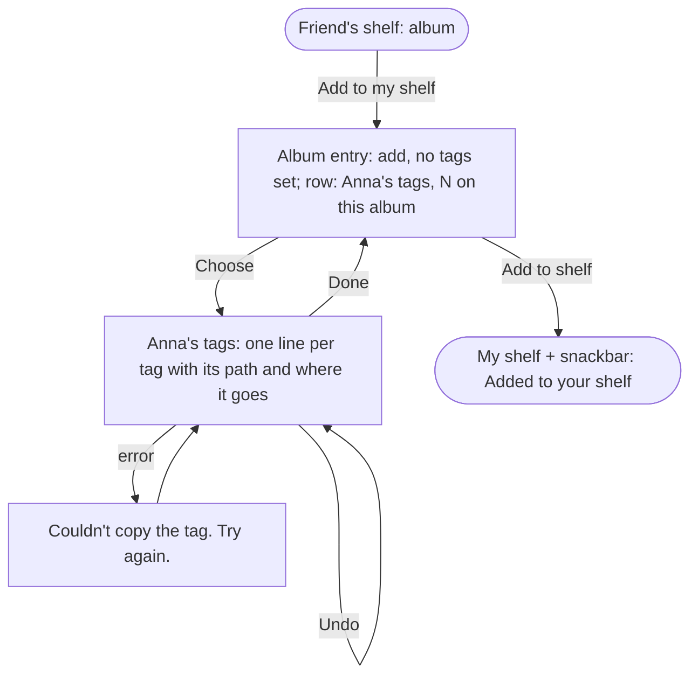

Notes:
- Built-in tags match by their key; like all tags, they are set only when tapped.
- Other tags match by name, ignoring case: in the matching group first,
  else anywhere in the user's tags.
- If your group of the same name is "several" while the friend's is "one",
  your group's type wins.
- A tag in a sub-group brings its parent tag along, created if needed.
- Tags in or under a built-in group you hide are not offered.
- A new group takes the friend's type (one or several per album).
- New tags and groups stay even if the user then cancels adding the album.
- The album remembers whose shelf it came from: "Added from Anna's shelf"
  under the artist, kept even if Anna's account is deleted.

# User flows (M2: friends)

M2 covers core use cases 3 and 4: invite a friend and view their shelf, and
read a feed of what friends add and rate. Friendships are mutual and start
from an invite. Friends see the whole shelf except entries hidden from
them. Screens: [screens.md](screens.md); wireframes:
[friends](wireframes/friends.html), [friend's shelf](wireframes/friend-shelf.html),
[feed](wireframes/feed.html).

## Your name (first sign-in)

Done: the user has a display name that friends see; they can change it
later.

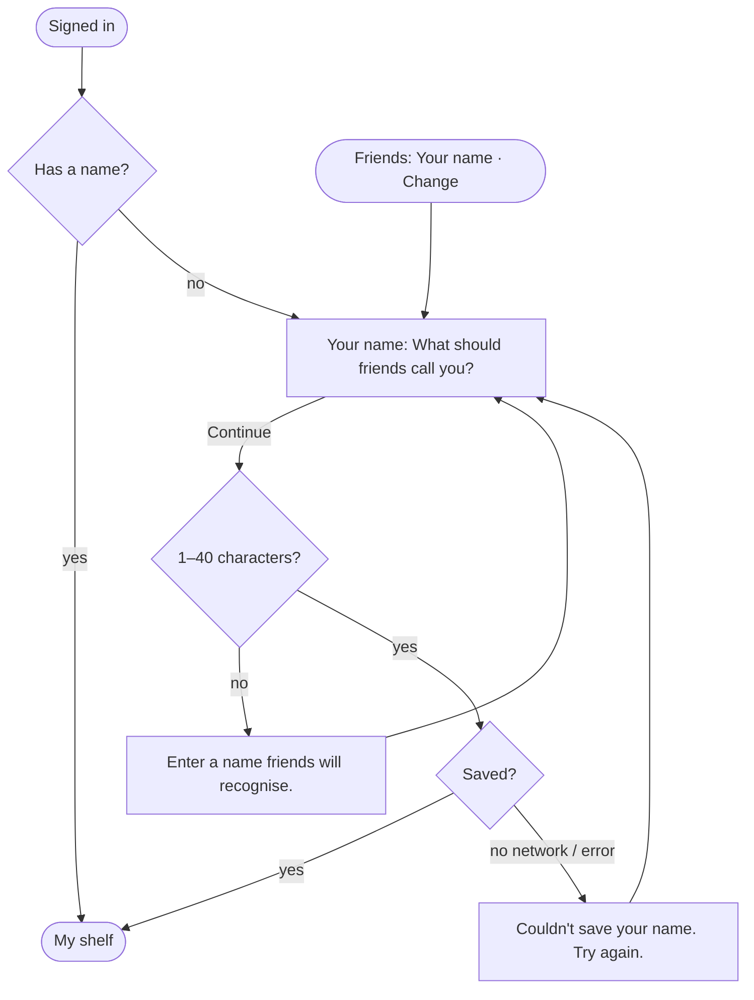

Notes:
- Asked once, right after the first sign-in, before My shelf; an invite
  being accepted waits until the name is set.
- No uniqueness: two friends may both be "Anna".

## Invite a friend

Done: the friend received a link (and a code) through any app on the
inviter's phone; the invite shows as waiting until it is used or expires.

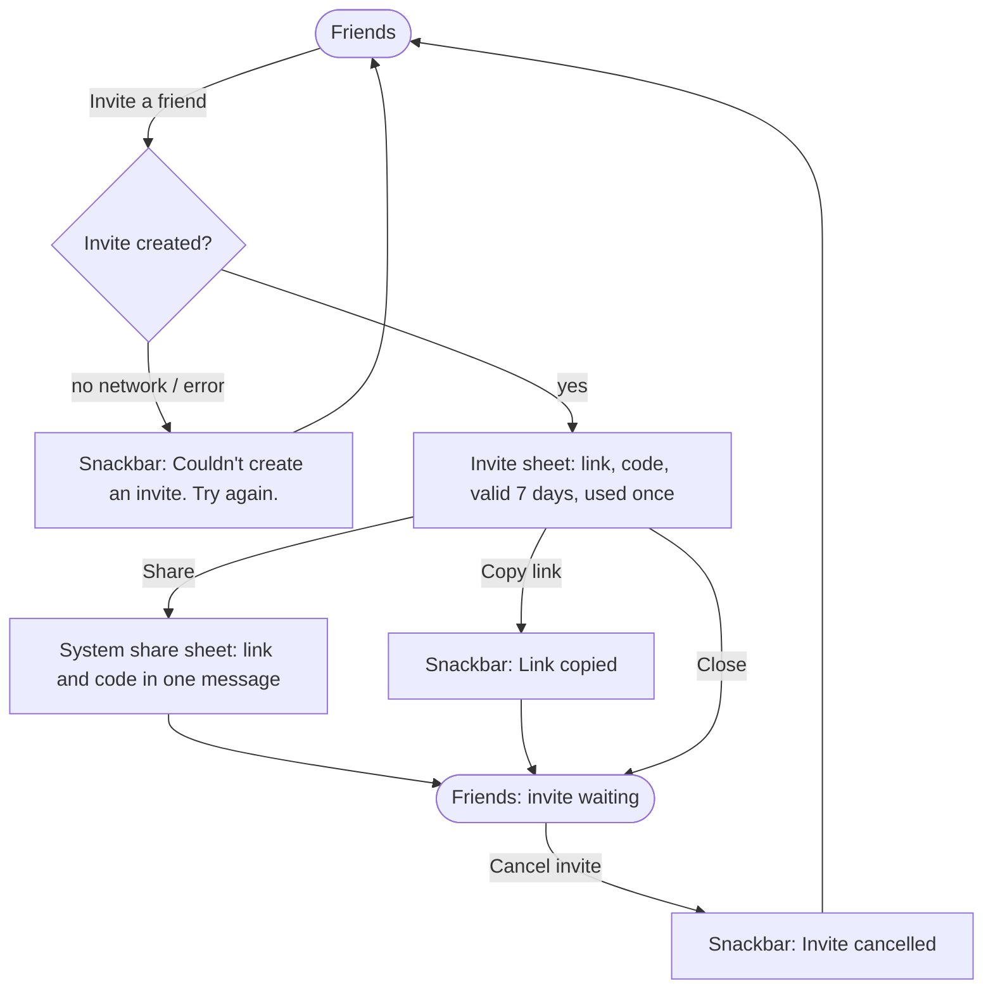

Notes:
- The message reads: "Anna invites you to shelf:
  de.schwubware.shelf://invite/K7Q2-M9XD (or open shelf and enter the code
  K7Q2-M9XD under Friends)". The link opens the Android app (decided
  2026-11-26: we own no web domain); iPhones and chat apps that don't make
  such links tappable use the code.
- Several invites can wait at once; each makes one friend.

## Accept an invite

Done: inviter and invitee are friends; the invitee sees the inviter's shelf.

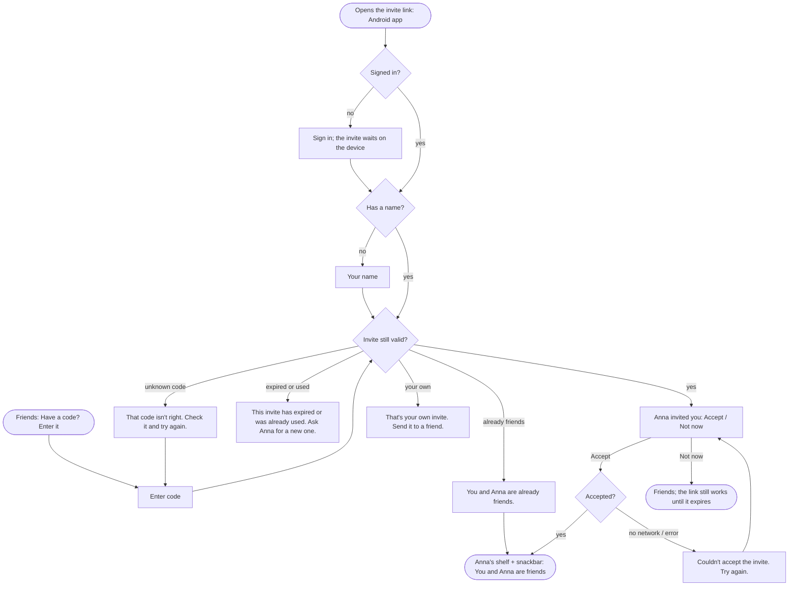

Built (TASK-36): the sign-in screen doesn't name the inviter (looking up an
invite needs a signed-in user); Close on an expired, own or already-friends
invite returns to Enter code, to try another; a cancelled invite reads as
unknown ("That invite doesn't exist"), since cancelling deletes it.

## Friends and their shelves

Done: the user browses a friend's shelf, opens an album and can add it to
their own shelf; or removes the friend.

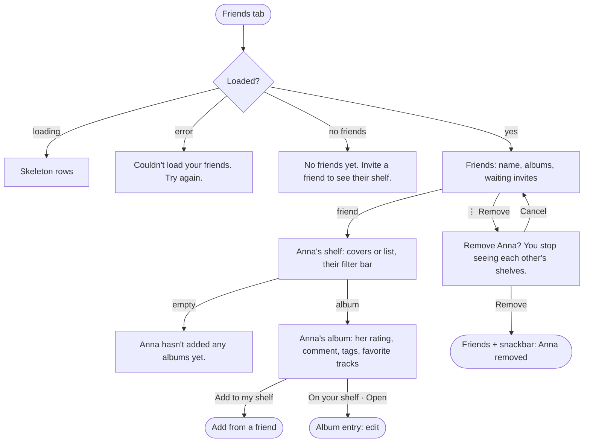

Notes:
- A friend's shelf is read-only and shows their own filter bar (changed
  2026-11-26 from built-in filters only) and the viewer's sort order.
- Removing a friend is mutual and immediate; albums already added from
  them stay, with "Added from Anna's shelf".

## Feed

Done: the user sees what friends added and rated, newest first, and can
open any of those albums.

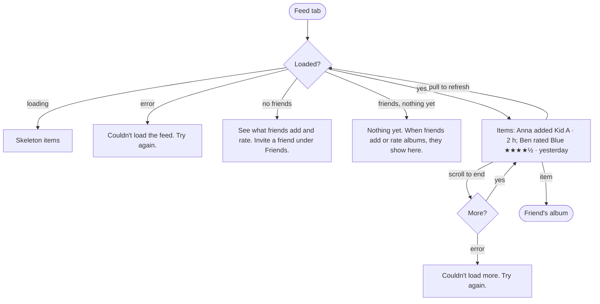

Notes:
- Two kinds of items: an album added, and a rating set or changed (one
  item per album and friend: a later rating replaces the earlier one).
- Hidden entries never appear; hiding an entry removes its items.

## Hide an entry from friends

Done: friends don't see the album on the user's shelf or in the feed; the
user still sees it, marked as hidden.

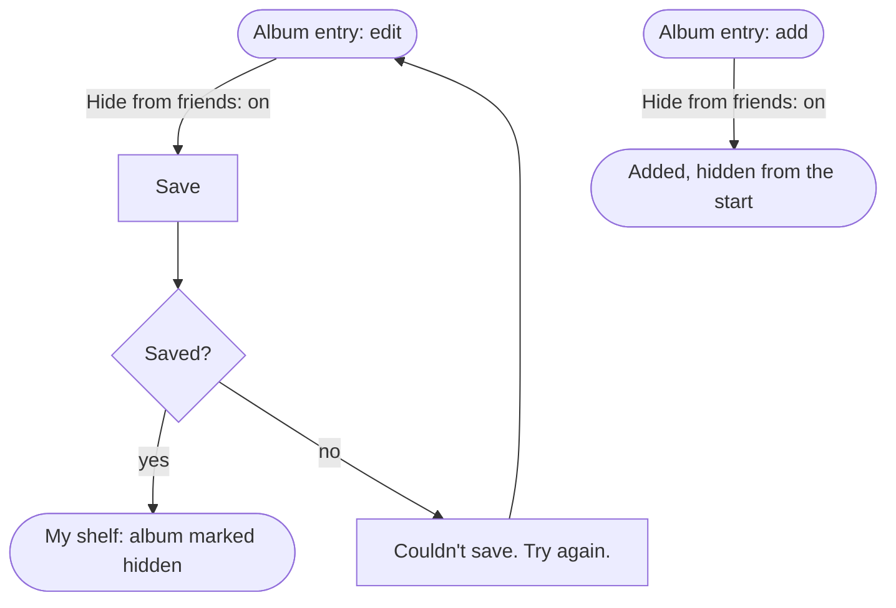

## Edit several albums (TASK-40)

Done: the chosen tags, hidden state or removal applies to every selected
album at once; anything else on them stays as it was.

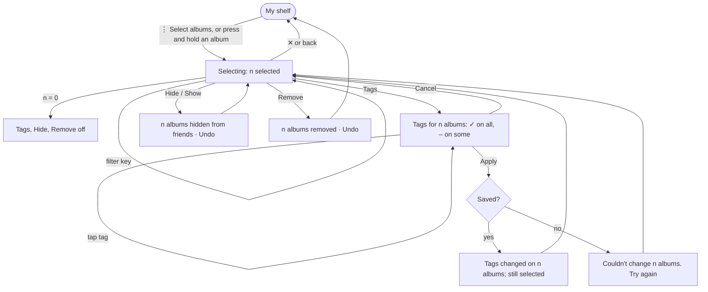

- Tags follow the rules of one album: in a one-per-album group the new tag
  replaces the other; a sub-tag puts its parent tag on too; taking a tag off
  takes its sub-tags off.
- Hide shows as Show when every selected album is already hidden.
- Not now: rating several albums, export, selecting on a friend's shelf.

