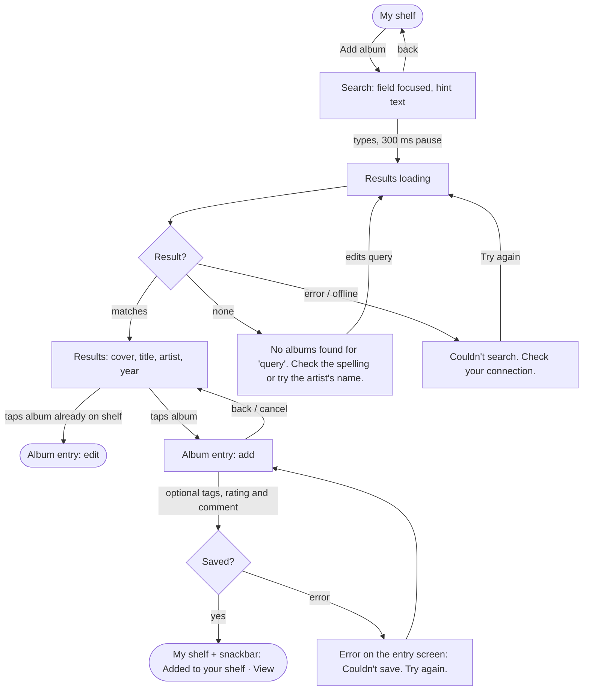
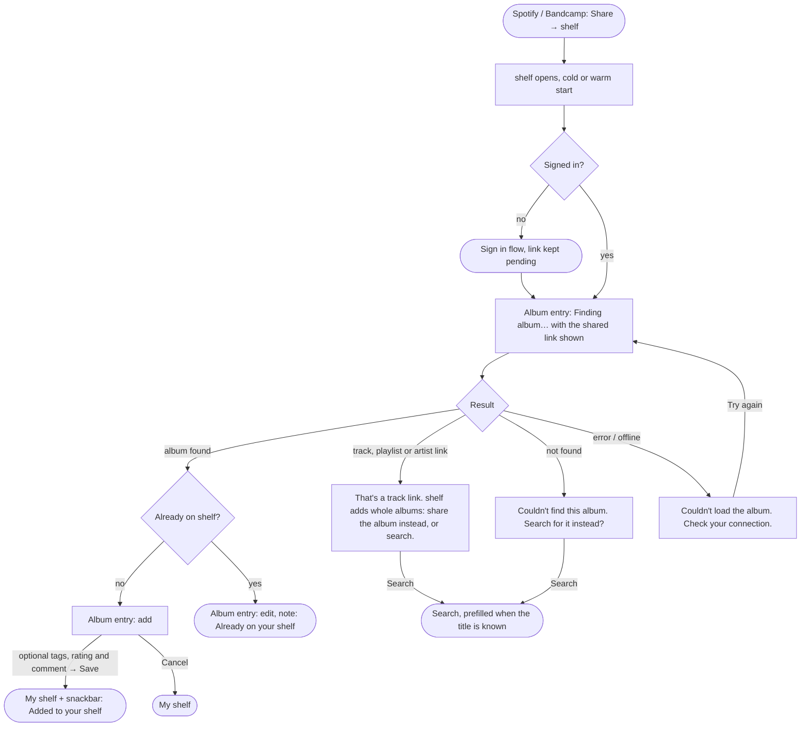
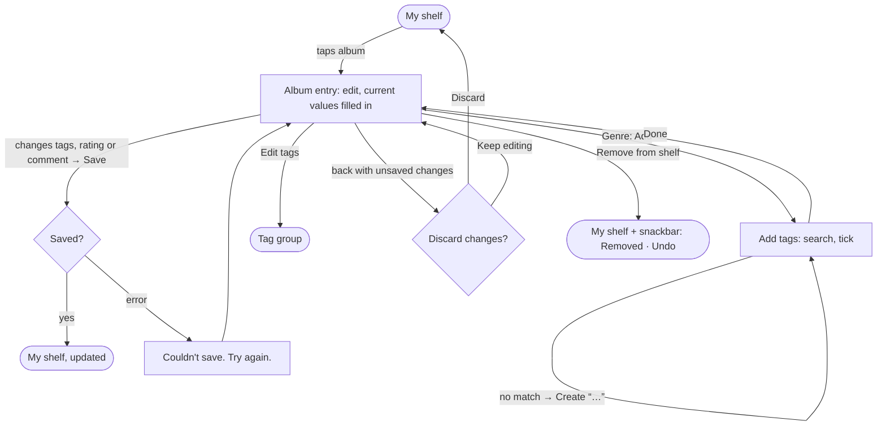
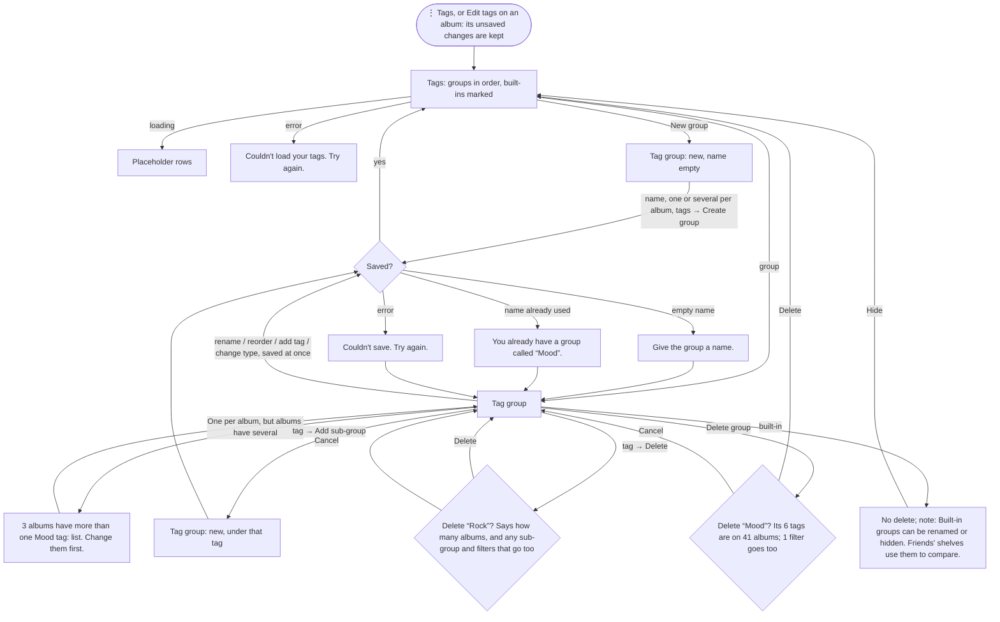
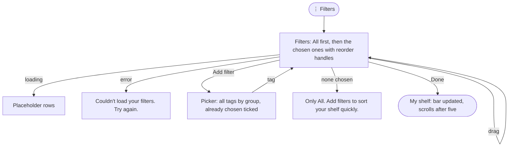
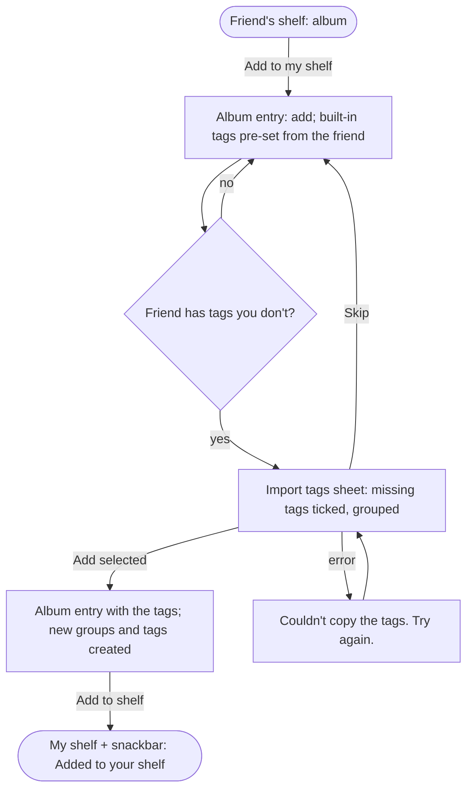

# User flows (M1)

M1 covers core use cases 1 and 2 from `docs/project.md`: add an album by
search or by sharing a link, and give it tags, a rating and a comment.
Tags are designed in [../features/tags.md](../features/tags.md); their
flows are at the end of this file.
Screens are listed in [screens.md](screens.md).

## Sign in (email magic link)

Done: the user is signed in and sees their shelf; they stay signed in
across app restarts.

Notes:
- The link signs in on the device where it is tapped. If the user opens the
  mail on another device, they sign in there; the check-email screen says so.
- A pending shared link (see "Add by sharing") survives the sign-in and
  continues afterwards.
- Sign out lives in the shelf's overflow menu and asks for confirmation.

## Add by search

Done: the album is on the shelf with any tags chosen, and the user is
back on the shelf with confirmation.

## Add by sharing a link

Done: the shared album is on the shelf.

## Tags, rating and comment

Done: the change is saved and visible on the shelf.

## My shelf: browsing

Done: the user finds an album on their shelf.

## Tag editor

Done: the user's groups and tags are as they want them, and every album
screen and filter reflects the change.

Notes: changes save immediately; deletes ask first and take effect at once.
Tag names are unique within a group, ignoring case, and can't be empty;
the same inline errors apply to tags. Deleting a tag also deletes the
sub-group under it and any filter on it. Sub-groups go one level deep.
Only built-in groups can be hidden.

## Filters

Done: the filter bar shows the chosen filters in the chosen order.

## Add from a friend (M2)

Done: the album is on the user's shelf with the friend's tags they chose to
copy; copies are ordinary, editable tags.

Notes:
- Built-in tags match by their key and are never asked about.
- Other tags match by group and tag name, ignoring case.
- If your group of the same name is "several" while the friend's is "one",
  your group's type wins.
- A tag in a sub-group whose parent tag you don't have brings the parent
  along, ticked together.
- A match in a hidden built-in group is applied and stays hidden.
- A copied new group takes the friend's type (one or several per album).
- Copies stay even if the user then cancels adding the album.
- The album remembers whose shelf it came from: "Added from Anna's shelf"
  under the artist, kept even if Anna's account is deleted.
