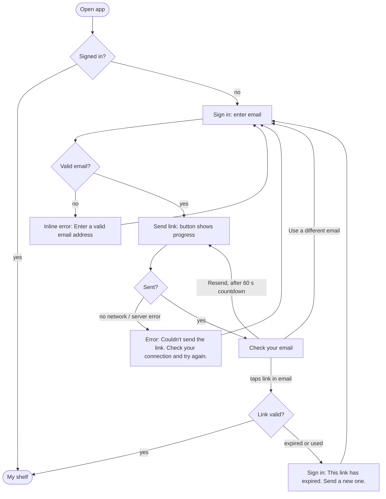
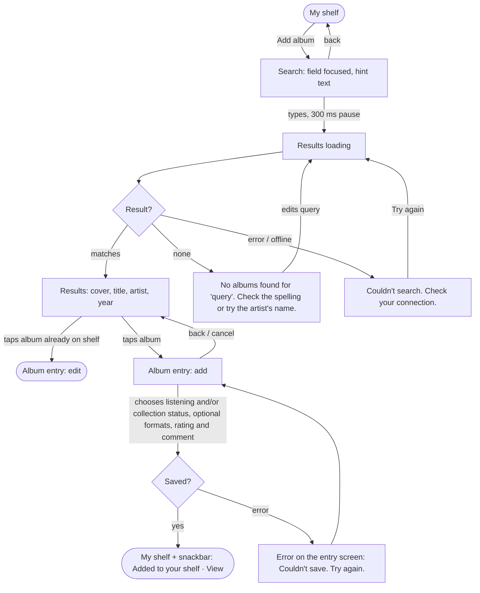
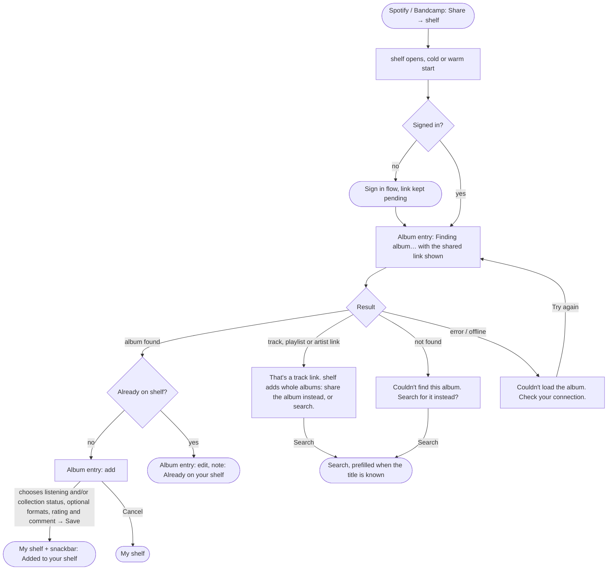
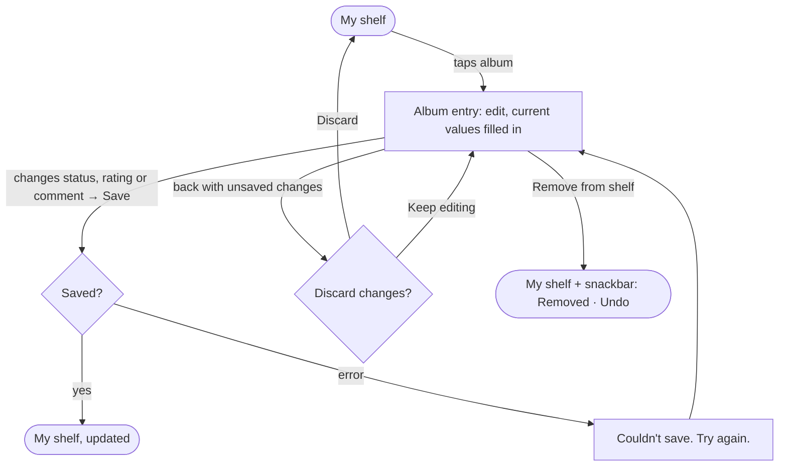
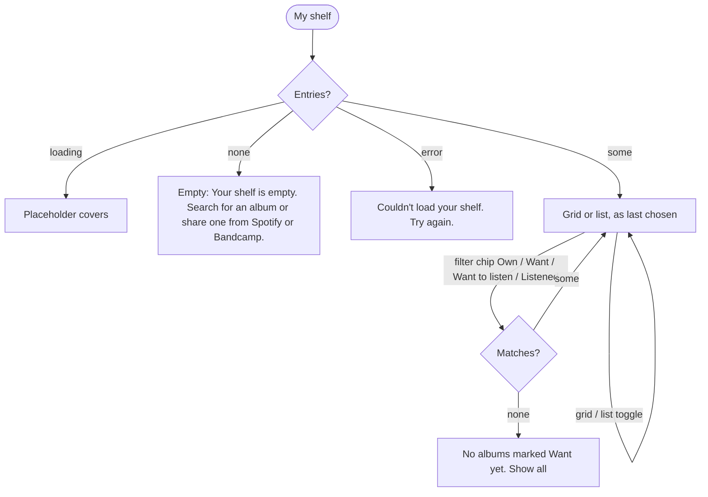

# User flows (M1)

M1 covers core use cases 1 and 2 from `docs/project.md`: add an album by
search or by sharing a link, and give it a listening and/or collection
status (with formats when owned), a rating and a comment.
Screens are listed in [screens.md](screens.md).

## Sign in (email magic link)

Done: the user is signed in and sees their shelf; they stay signed in
across app restarts.

Notes:
- The link signs in on the device where it is tapped. If the user opens the
  mail on another device, they sign in there; the check-email screen says so.
- A pending shared link (see "Add by sharing") survives the sign-in and
  continues afterwards.
- Sign out lives in the shelf's overflow menu and asks for confirmation.

## Add by search

Done: the album is on the shelf with the chosen status, and the user is
back on the shelf with confirmation.

## Add by sharing a link

Done: the shared album is on the shelf with the chosen status.

## Status, rating and comment

Done: the change is saved and visible on the shelf.

## My shelf: browsing

Done: the user finds an album on their shelf.

