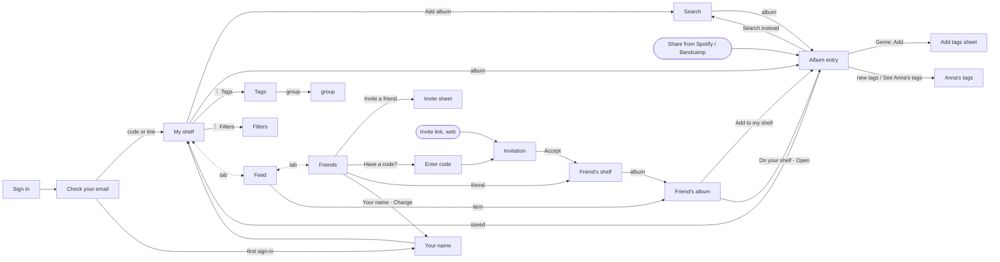

# Screens (M1, M2)

Material 3 on all platforms (the app already uses `MaterialApp`), phone
first; the web build uses the same layout, centred at phone width for now.
Flows are in [flows.md](flows.md), wireframes in [wireframes/](wireframes/).

| Screen | Purpose | Flows | States |
|---|---|---|---|
| Sign in | Enter an email to get a sign-in code and link | Sign in | default, sending, invalid email, send error, too many emails, link failed |
| Check your email | Enter the emailed code; resend it or change the email | Sign in | sent (resend countdown), resend available, code not 6 digits, wrong or expired code, resent |
| My shelf | The user's albums; start adding | all | loading, empty, filled grid, filled list, filter with no matches, error |
| Search | Find an album on MusicBrainz | Add by search | idle, loading, results (some already on shelf), no results, error |
| Album entry | Add an album or edit its entry: tags, rating, comment | Add by search, Add by sharing, Tags/rating/comment | resolving (shared link), add, edit, already on shelf, not an album, not found, load error, save error |
| Add tags (sheet) | Pick tags of a large group, search, create a new tag | Tags/rating/comment | list, search with matches, no match (offer Create), save error |
| Tags | The user's tag groups; open the editor for one | Tag editor | loading, list, error |
| Tag group | Edit a group: name, one or several per album, its tags, sub-groups, hide or delete | Tag editor | new, existing, built-in, delete confirmation, can't make exclusive, duplicate name, save error |
| Filters | Choose and order the filters of the shelf's filter bar | Filters | loading, list, empty (only All), add picker, error |
| Anna's tags (M2, TASK-48) | After adding an album from a friend: their tags on the album, none ticked, each going to any of the user's groups or tags (wireframe [copy-tags](wireframes/copy-tags.html) shows the first version) | Add from a friend | none ticked, Tick the N that match, target picker, sub-tag with its parent, copying, no tags (skipped; link on the entry), copy error |
| Your name (M2) | Set the name friends see; asked once after the first sign-in, changeable from Friends | Your name, Accept an invite | first time, change, too long or empty, save error |
| Feed (M2, tab) | What friends added and rated, newest first | Feed | loading, no friends, nothing yet, filled, loading more, error, error loading more (no automatic retry) |
| Friends (M2, tab) | Friends and waiting invites; invite, enter a code, remove | Invite, Accept, Friends | loading, no friends, filled, invites waiting, error |
| Invite (sheet, M2) | The new invite's link and code; share or copy | Invite a friend | created, creating, error (snackbar) |
| Enter code (M2) | Type or paste an invite code | Accept an invite | empty, wrong code, checking |
| Invitation (M2) | "Anna invited you": accept or not now | Accept an invite | valid, expired or used, own invite, already friends, accepting, error |
| Friend's shelf (M2) | A friend's albums, read-only, with their filters | Friends and their shelves | loading, empty, filled grid, filled list, filter with no matches, error |
| Friend's album (M2) | One album as the friend has it: rating, comment, tags, favorite tracks; add it | Friends and their shelves, Feed | not on your shelf (Add to my shelf), on your shelf (Open), load error |
| My shelf: selecting (TASK-40) | Select several albums and change their tags, hide or remove them | Edit several albums | none selected (actions off), some selected, all in filter selected, applied, error |
| Tags for several (sheet, TASK-40) | Put tags on or take them off all selected albums | Edit several albums | mixed (✓ / – / empty, with counts), one-per-album note, saving, error |

One screen, **Album entry**, serves both adding and editing, so tags,
rating and comment work the same everywhere. In add mode the primary action
is "Add to shelf"; in edit mode it is "Save" and "Remove from shelf" is
offered.

## Navigation

- M2: a tab bar with Shelf, Feed and Friends as low keys (`ShelfTabBar`,
  the chosen one pressed; changed 2026-11-26 from Material's bar; in that
  order; Shelf is where the app opens). My shelf keeps its own bottom row
  (Covers / List and Add album) directly above the navigation bar. Each tab
  keeps its own back stack: a friend's shelf opened from Friends stays
  there when switching tabs. Sign-in, Your name and the Invitation screen
  are full screen, without the bar.
- Back follows the platform: system back / swipe on phones, the app bar back
  arrow everywhere. Back from Album entry after a share goes to My shelf.
- Overflow menu (⋮) on My shelf: Select albums, Tags, Filters, Sign out
  (with a confirmation dialog). Selecting (TASK-40, wireframe
  [select](wireframes/select.html)) swaps the app bar for "n selected", ✕
  and Select all, and the bottom row for Tags, Hide and Remove.

## Interaction decisions
- **Tags** (design in [../features/tags.md](../features/tags.md)): the album
  entry lists the user's visible tag groups in their order.
  - Each group shows on albums one of two ways (set in the editor, "On
    albums"): all its tags as keys, tapping a pressed key releases it; or
    "Pick from a list" (Genre), showing only this album's tags, each with
    a ✕ that takes it off the album (TASK-28).
  - List groups and multiple-choice key groups have an "Add" action on the
    right of their label line, which opens the Add tags sheet: the tags in
    alphabetical order to scroll or search, tick tags, and "Create “…”"
    when nothing matches. New groups are made in the editor.
  - A sub-group appears under its parent tag only while that tag is
    pressed (Format under Own); releasing the parent removes its sub-tags.
  - No tag is required: "Add to shelf" is always available.
- **Added from a friend (M2):** "Added from Anna's shelf" under the artist
  on the album entry, for as long as the album is on the shelf.
  - The tag editor is reached only from My shelf's ⋮ menu (Tags), not from
    the album entry (TASK-29, 2026-11-25).
- **Tag editor:** Tags lists the groups (built-in ones marked); Tag group
  edits one. Changes save immediately (no Save or Cancel), except a new
  group, which is created with "Create group". Tapping a tag opens its
  actions: rename, add or edit its sub-group, delete. Sub-groups go one
  level deep (like Format under Own); the data model allows deeper, the
  editor doesn't offer it. Only built-in groups can be hidden. Built-in groups can be renamed and hidden, not deleted; the
  delete action is replaced by a note saying why. Hiding a group hides its
  tags on the album entry and its filters, without removing them from
  albums; a hidden group is shown again from its own screen. Deleting a tag
  or group asks first, says how many albums, sub-groups and filters it
  affects, and takes effect at once; making a group "one per album" while albums have
  several of its tags is refused with the list of those albums.
- **Filters:** chosen from ⋮ → Filters; changes save immediately; "All" is
  always first. The bar shows them in order and scrolls sideways after
  five. Tags of hidden groups aren't offered. Custom filters combine tags,
  rating and favorite tracks ([../features/filters.md](../features/filters.md)).
- **Rating** is optional: five 44 px keys, each a bar of the rating meter.
  Tapping a key sets that many stars, tapping the same key again makes it a
  half, tapping it a third time clears the rating. Screen readers get
  "Rating, 3.5 of 5 stars" with increase / decrease actions in half-star
  steps.
- **Comment** is an optional multi-line field labelled "Comment (optional)".
- **Covers / list** toggle in the bottom bar next to "Add album"; the
  choice follows the user to every device. Next to it a **Sort** key opens
  a sheet: Date added (newest first), Title and Artist (A–Z), Year (newest
  first), Rating (highest first); the chosen order tapped again turns
  round. Albums without a year or rating go last; a friend's shelf shows
  in the user's order (TASK-39). A filter bar (labels above keys, each key showing its count) sits above
  the albums; it starts with All, Own, Want, Want to listen, Listened. Look and components: [visual-system.md](visual-system.md).
- **Friends (M2):** mutual, from an invite only (no user search). An
  invite is a link plus an 8-character code (`K7Q2-M9XD`), used once,
  valid 7 days, cancellable while waiting (no Undo: invite again). Removing
  a friend asks first and is mutual. "Invite a friend" is a key at the end
  of the list rather than a floating button, like the app's other keys;
  album counts per friend come with TASK-37, when friends' albums are
  readable.
- **Hidden from friends (M2):** a switch on the album entry, "Hide from
  friends", with the help line "Friends don't see this album, and it stays
  out of the feed." Hidden albums carry a small eye-off mark on My shelf.
- **A friend's shelf** looks like My shelf without anything to edit: no
  Add album, no ⋮ menu; their own filters and the user's Sort key (one
  order for both shelves). Their tags show on
  their album as plain labels. Its Covers / List keys are for that screen
  only. "Add to my shelf" opens Album entry in add mode (TASK-19 adds
  copying their tags); an album they added by hand becomes the user's own
  copy (a new manual album). Changes made there reload My shelf.
- Confirmation after adding or removing an album is a snackbar; removing
  offers Undo instead of a confirmation dialog. Deletes that affect many
  albums (a tag or group in the editor) ask first with a dialog instead.
