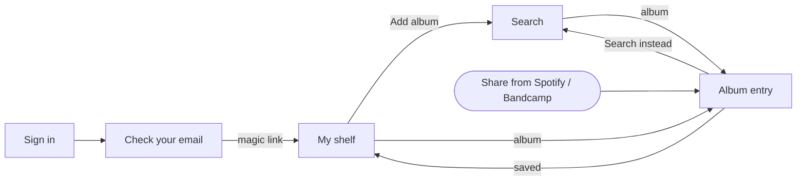

# Screens (M1)

Material 3 on all platforms (the app already uses `MaterialApp`), phone
first; the web build uses the same layout, centred at phone width for now.
Flows are in [flows.md](flows.md), wireframes in [wireframes/](wireframes/).

| Screen | Purpose | Flows | States |
|---|---|---|---|
| Sign in | Enter an email to get a sign-in link | Sign in | default, sending, invalid email, send error, link expired |
| Check your email | Tell the user where the link went; resend or change email | Sign in | sent (resend countdown), resend available |
| My shelf | The user's albums; start adding | all | loading, empty, filled grid, filled list, filter with no matches, error |
| Search | Find an album on MusicBrainz | Add by search | idle, loading, results (some already on shelf), no results, error |
| Album entry | Add an album or edit its entry: status, rating, comment | Add by search, Add by sharing, Status/rating/comment | resolving (shared link), add, edit, already on shelf, not an album, not found, load error, save error |

One screen, **Album entry**, serves both adding and editing, so status,
rating and comment work the same everywhere. In add mode the primary action
is "Add to shelf"; in edit mode it is "Save" and "Remove from shelf" is
offered.

## Navigation

- My shelf is the only top-level screen in M1, so there is no bottom
  navigation yet. M2 adds Feed and Friends; then a Material navigation bar
  with Shelf, Feed and Friends replaces the single screen.
- Back follows the platform: system back / swipe on phones, the app bar back
  arrow everywhere. Back from Album entry after a share goes to My shelf.
- Sign out: overflow menu (⋮) on My shelf, with a confirmation dialog.

## Interaction decisions
- **Status** is a three-way segmented button: Own, Want, Listened. Adding
  needs a status; "Add to shelf" stays disabled until one is chosen.
- **Rating** is optional: five 48 px stars. Tapping a star sets that many
  stars, tapping the same star again makes it a half star, "Clear" removes
  the rating. Screen readers get "Rating, 3.5 of 5 stars" with increase /
  decrease actions in half-star steps.
- **Comment** is an optional multi-line field labelled "Comment (optional)".
- **Grid / list** toggle in the shelf's app bar; the choice is remembered on
  the device. Filter chips (All, Own, Want, Listened) sit above the albums.
- Confirmation after adding or removing is a snackbar; removing offers Undo
  instead of a confirmation dialog.
