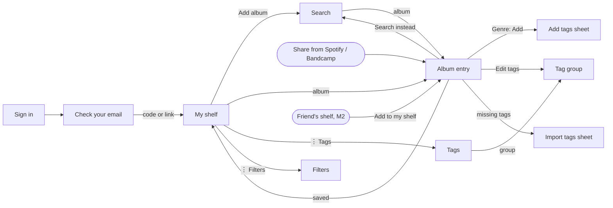

# Screens (M1)

Material 3 on all platforms (the app already uses `MaterialApp`), phone
first; the web build uses the same layout, centred at phone width for now.
Flows are in [flows.md](flows.md), wireframes in [wireframes/](wireframes/).

| Screen | Purpose | Flows | States |
|---|---|---|---|
| Sign in | Enter an email to get a sign-in code and link | Sign in | default, sending, invalid email, send error, too many emails, link failed |
| Check your email | Enter the emailed code; resend it or change the email | Sign in | sent (resend countdown), resend available, code not 6 digits, wrong or expired code, resent |
| My shelf | The user's albums; start adding | all | loading, empty, filled grid, filled list, filter with no matches, error |
| Search | Find an album on MusicBrainz | Add by search | idle, loading, results (some already on shelf), no results, error |
| Album entry | Add an album or edit its entry: tags, rating, comment | Add by search, Add by sharing, Tags/rating/comment | resolving (shared link), add, edit, already on shelf, not an album, not found, load error, save error |
| Add tags (sheet) | Pick tags of a large group, search, create a new tag | Tags/rating/comment | list, search with matches, no match (offer Create), save error |
| Tags | The user's tag groups; open the editor for one | Tag editor | loading, list, error |
| Tag group | Edit a group: name, one or several per album, its tags, sub-groups, hide or delete | Tag editor | new, existing, built-in, delete confirmation, can't make exclusive, duplicate name, save error |
| Filters | Choose and order the filters of the shelf's filter bar | Filters | loading, list, empty (only All), add picker, error |
| Import tags (sheet, M2) | After adding an album from a friend: copy their tags you don't have | Add from a friend | missing tags, nothing missing (not shown), save error |

One screen, **Album entry**, serves both adding and editing, so tags,
rating and comment work the same everywhere. In add mode the primary action
is "Add to shelf"; in edit mode it is "Save" and "Remove from shelf" is
offered.

## Navigation

- My shelf is the only top-level screen in M1, so there is no bottom
  navigation yet. M2 adds Feed and Friends; then a Material navigation bar
  with Shelf, Feed and Friends replaces the single screen.
- Back follows the platform: system back / swipe on phones, the app bar back
  arrow everywhere. Back from Album entry after a share goes to My shelf.
- Overflow menu (⋮) on My shelf: Tags, Filters, Sign out (with a
  confirmation dialog).

## Interaction decisions
- **Tags** (design in [../features/tags.md](../features/tags.md)): the album
  entry lists the user's visible tag groups in their order.
  - A group with up to six tags shows all of them as keys; a larger group
    shows only this album's tags. Tapping a pressed key releases it.
  - Multiple-choice groups have an "Add" action on the right of their
    label line, which opens the Add tags sheet: search, tick tags, and
    "Create “…”" when nothing matches. New groups are made in the editor.
  - A sub-group appears under its parent tag only while that tag is
    pressed (Format under Own); releasing the parent removes its sub-tags.
  - No tag is required: "Add to shelf" is always available.
- **Added from a friend (M2):** "Added from Anna's shelf" under the artist
  on the album entry, for as long as the album is on the shelf.
  - "Edit tags" at the end of the section opens the Tags list; the album's
    unsaved changes are kept for when the user comes back.
- **Tag editor:** Tags lists the groups (built-in ones marked); Tag group
  edits one. Changes save immediately (no Save or Cancel), except a new
  group, which is created with "Create group". Tapping a tag opens its
  actions: rename, add or edit its sub-group, delete. Sub-groups go one
  level deep (like Format under Own); the data model allows deeper, the
  editor doesn't offer it. Only built-in groups can be hidden. Built-in groups can be renamed and hidden, not deleted; the
  delete action is replaced by a note saying why. Hiding a group hides its
  tags on the album entry and its filters, without removing them from
  albums; a hidden group is shown again from its own screen. Deleting a tag
  or group asks first, says how many albums, sub-groups and filters it
  affects, and takes effect at once; making a group "one per album" while albums have
  several of its tags is refused with the list of those albums.
- **Filters:** chosen from ⋮ → Filters; changes save immediately; "All" is
  always first. The bar shows them in order and scrolls sideways after
  five. Tags of hidden groups aren't offered.
- **Rating** is optional: five 44 px keys, each a bar of the rating meter.
  Tapping a key sets that many stars, tapping the same key again makes it a
  half, tapping it a third time clears the rating. Screen readers get
  "Rating, 3.5 of 5 stars" with increase / decrease actions in half-star
  steps.
- **Comment** is an optional multi-line field labelled "Comment (optional)".
- **Covers / spines** toggle in the bottom bar next to "Add album"; the
  choice is remembered on the device. A filter bar (labels above keys, each key showing its count) sits above
  the albums; it starts with All, Own, Want, Want to listen, Listened. Look and components: [visual-system.md](visual-system.md).
- Confirmation after adding or removing an album is a snackbar; removing
  offers Undo instead of a confirmation dialog. Deletes that affect many
  albums (a tag or group in the editor) ask first with a dialog instead.
